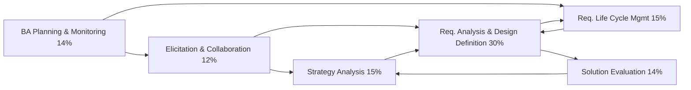

# CBAP Knowledge Graph

> [!info] How to use
> Open **Graph view**, and filter by tag or folder (for example `tag:#cbap/task`) to see one layer at a time. Every task links to its inputs, outputs, techniques and stakeholders, so following links traces the whole BABOK flow.

## Layers
| Layer | Notes | Start here |
|---|---|---|
| Foundations | BACCM, 6 core concepts, key terms, requirements classification, 11 stakeholder roles | [[BACCM]] · [[Requirements Classification Schema]] · [[Stakeholder Roles]] |
| Knowledge Areas | 6 | [[Business Analysis Planning and Monitoring]] · [[Elicitation and Collaboration]] · [[Requirements Life Cycle Management]] · [[Strategy Analysis]] · [[Requirements Analysis and Design Definition]] · [[Solution Evaluation]] |
| Tasks | 30 | pick from any KA note |
| Inputs & Outputs | 71 | [[Requirements]] · [[Elicitation Results]] · [[Designs]] |
| Techniques | 50 | [[Technique-Task Matrix]] |
| Underlying Competencies | 6 groups, 29 competencies | [[Underlying Competencies]] |
| Perspectives | 5 | [[Perspectives]] |
| Exam lens | blueprint, I/O flow, confusions, matrix | [[Exam Blueprint]] · [[BABOK Input-Output Flow]] · [[Commonly Confused Concepts]] |

## The BABOK in one picture

Sources: [[Sources]]
