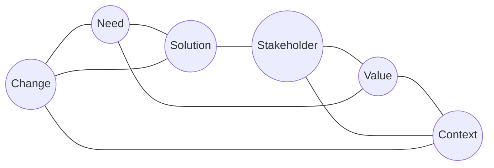

# Business Analysis Core Concept Model (BACCM)

> [!abstract] Six equal concepts
> Each core concept is defined by the other five and none is more important than another. If any one changes, re-evaluate the others and their relationship to value. *(BABOK 2.1, p.12)*

| Concept | Definition | Question to ask |
|---|---|---|
| [[Change]] | A transformation made in response to a need. | What kind of change are we making? |
| [[Need]] | A problem to solve or an opportunity to pursue. | Which problem or opportunity are we addressing? |
| [[Solution]] | A particular way of meeting one or more needs within a context. | What are we building or changing to meet the need? |
| [[Stakeholder]] | Anyone (individual or group) connected to the change, the need or the solution. | Who is involved or affected? |
| [[Value]] | How much something is worth, or how important or useful it is, to a stakeholder in a given context. | What does each stakeholder regard as valuable? |
| [[Context]] | The surrounding circumstances that shape the change, are shaped by it, and help explain it. | What surrounds the change and the solution? |

## BACCM in each Knowledge Area
- [[Business Analysis Planning and Monitoring]]
- [[Elicitation and Collaboration]]
- [[Requirements Life Cycle Management]]
- [[Strategy Analysis]]
- [[Requirements Analysis and Design Definition]]
- [[Solution Evaluation]]

## Uses of the BACCM
- describe the profession and domain of business analysis
- communicate with a common terminology
- evaluate relationships among the key concepts
- check the quality and completeness of work at any point

## Study guides
- Lessing ch.5 *Business Analysis Foundation Concepts*, pp.48–51
- Jonasson ch.3 *BABOK Overview*, 3.3 Key Concepts, p.25
