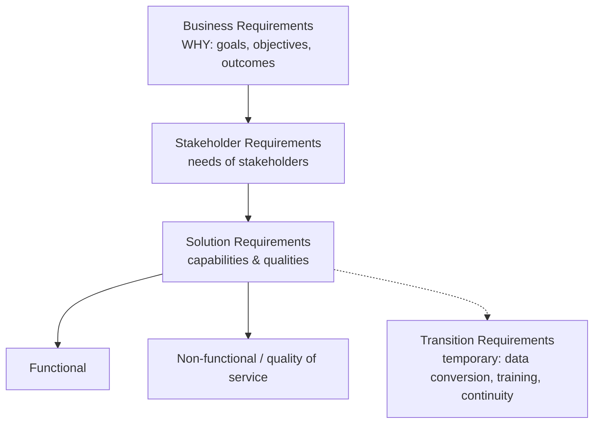

# Requirements Classification Schema (BABOK 2.3)

| Type | What it describes | Example |
|---|---|---|
| **Business** | Goals, objectives and outcomes — *why* the change was initiated (enterprise, business area, or initiative level). | Increase online sales by 15% in 12 months. |
| **Stakeholder** | Needs of stakeholders that must be met to achieve business requirements; bridge between business and solution requirements. | Store managers need a daily view of stock levels. |
| **Solution – functional** | Capabilities: the behaviour and information the solution manages. | The system shall send an order confirmation email. |
| **Solution – non-functional** | Conditions under which the solution must remain effective, or qualities it must have. | Pages load in under 2 seconds for 95% of requests. |
| **Transition** | Capabilities/conditions needed only to move from current to future state; temporary. | Migrate 5 years of order history; train 200 staff. |

> [!tip] Exam lens
> Transition requirements are the only *temporary* type. Business requirements originate in [[Analyze Current State]] as [[Business Requirements]]. NFRs are analysed with [[Non-Functional Requirements Analysis]].

Study guides: Lessing pp.59–62 · Jonasson ch.8 (RADD) pp.169–172
