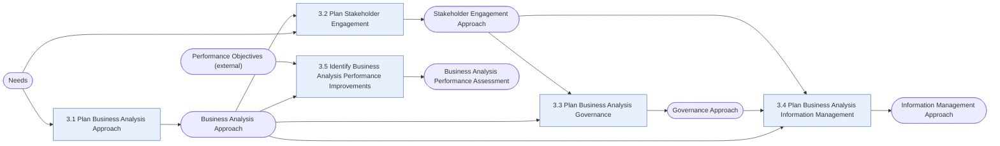

# Business Analysis Planning and Monitoring (BAPM)

> [!info] Exam weight: **14%** of CBAP questions (≈17 of 120)
> Plan HOW business analysis will be done: approach, stakeholders, governance, information management, and continuous improvement of BA work itself.

## Tasks
| Task | Purpose | Outputs |
|---|---|---|
| [[Plan Business Analysis Approach|3.1 Plan Business Analysis Approach]] | Decide how business analysis will be carried out on this initiative: the overall method, its formality, the activities, their timing, and how the approach gets agreed. | [[Business Analysis Approach]] |
| [[Plan Stakeholder Engagement|3.2 Plan Stakeholder Engagement]] | Work out who the stakeholders are, what they are like, and how the BA will work and communicate with each of them. | [[Stakeholder Engagement Approach]] |
| [[Plan Business Analysis Governance|3.3 Plan Business Analysis Governance]] | Set the rules for decisions about requirements and designs: who decides, how changes are controlled, how priorities are set, and how approvals happen. | [[Governance Approach]] |
| [[Plan Business Analysis Information Management|3.4 Plan Business Analysis Information Management]] | Decide how business analysis information will be organized, detailed, traced, reused, stored and described with attributes. | [[Information Management Approach]] |
| [[Identify Business Analysis Performance Improvements|3.5 Identify Business Analysis Performance Improvements]] | Evaluate how well the business analysis work itself is going, and put improvements in place. | [[Business Analysis Performance Assessment]] |

## Input → task → output flow

**Inputs from outside this KA:** [[Needs]], [[Performance Objectives (external)]]

## Most-used techniques in this KA
- [[Brainstorming]] — used in 5 of 5 tasks
- [[Interviews]] — used in 5 of 5 tasks
- [[Lessons Learned]] — used in 5 of 5 tasks
- [[Process Modelling]] — used in 5 of 5 tasks
- [[Survey or Questionnaire]] — used in 5 of 5 tasks
- [[Workshops]] — used in 5 of 5 tasks
- [[Item Tracking]] — used in 4 of 5 tasks
- [[Document Analysis]] — used in 3 of 5 tasks
- [[Reviews]] — used in 3 of 5 tasks
- [[Risk Analysis and Management]] — used in 3 of 5 tasks
- [[Mind Mapping]] — used in 2 of 5 tasks
- [[Organizational Modelling]] — used in 2 of 5 tasks

> [!tip] Exam lens
> - Its outputs are mostly *approaches* that act as guidelines for nearly every other task — know the five outputs by heart.
> - Only KA whose inputs include something "external" at the start: Needs and Performance Objectives (external).
> - Questions often ask "what should the BA do FIRST" — planning/tailoring the approach usually precedes elicitation.
> - Predictive vs adaptive trade-offs (formality, timing, level of detail) are heavily tested.

## Study guides
- **BABOK v3** chapter 3
- **Lessing** ch.6 *Business Analysis Planning and Monitoring*, pp.73–109 (incl. knowledge quiz)
- **Jonasson** Ch 4 Business Analysis Planning and Monitoring, from p.33

Up: [[00 CBAP Knowledge Graph]]
