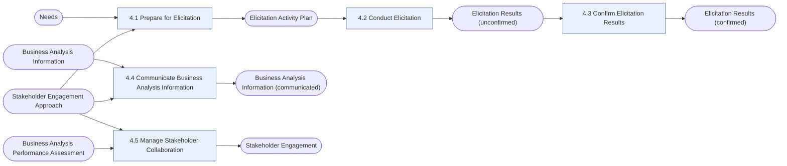

# Elicitation and Collaboration (E&C)

> [!info] Exam weight: **12%** of CBAP questions (≈14 of 120)
> Draw out, confirm, and communicate information with stakeholders, and keep them collaborating throughout the change.

## Tasks
| Task | Purpose | Outputs |
|---|---|---|
| [[Prepare for Elicitation|4.1 Prepare for Elicitation]] | Get ready for an elicitation activity: its scope, the techniques, the logistics, the materials, and the people taking part. | [[Elicitation Activity Plan]] |
| [[Conduct Elicitation|4.2 Conduct Elicitation]] | Run the elicitation activity: draw out and explore information with stakeholders or from sources, and record what comes out of it. | [[Elicitation Results (unconfirmed)]] |
| [[Confirm Elicitation Results|4.3 Confirm Elicitation Results]] | Check that what was elicited is accurate and consistent, by comparing it with sources and with other results. | [[Elicitation Results (confirmed)]] |
| [[Communicate Business Analysis Information|4.4 Communicate Business Analysis Information]] | Make sure stakeholders share the same understanding of business analysis information, using the right format and channel for each audience. | [[Business Analysis Information (communicated)]] |
| [[Manage Stakeholder Collaboration|4.5 Manage Stakeholder Collaboration]] | Keep stakeholders engaged and working together towards the shared goal for the whole initiative. | [[Stakeholder Engagement]] |

## Input → task → output flow

**Inputs from outside this KA:** [[Business Analysis Information]], [[Business Analysis Performance Assessment]], [[Needs]], [[Stakeholder Engagement Approach]]

## Most-used techniques in this KA
- [[Interviews]] — used in 4 of 5 tasks
- [[Document Analysis]] — used in 3 of 5 tasks
- [[Workshops]] — used in 3 of 5 tasks
- [[Brainstorming]] — used in 2 of 5 tasks
- [[Collaborative Games]] — used in 2 of 5 tasks
- [[Data Mining]] — used in 2 of 5 tasks
- [[Mind Mapping]] — used in 2 of 5 tasks
- [[Reviews]] — used in 2 of 5 tasks
- [[Risk Analysis and Management]] — used in 2 of 5 tasks
- [[Stakeholder List, Map, or Personas]] — used in 2 of 5 tasks
- [[Benchmarking and Market Analysis]] — used in 1 of 5 tasks
- [[Business Rules Analysis]] — used in 1 of 5 tasks

> [!tip] Exam lens
> - Elicitation results move from *unconfirmed* (4.2) to *confirmed* (4.3) — watch the state labels.
> - Confirm ≠ verify/validate: confirming checks the BA understood the stakeholder correctly (accuracy & consistency).
> - Elicitation types: collaborative, research, experiments — know examples of each.
> - 4.4 and 4.5 are ongoing tasks: communication and collaboration happen throughout the initiative.

## Study guides
- **BABOK v3** chapter 4
- **Lessing** ch.7 *Elicitation and Collaboration*, pp.110–147 (incl. knowledge quiz)
- **Jonasson** Ch 5 Elicitation and Collaboration, from p.73

Up: [[00 CBAP Knowledge Graph]]
