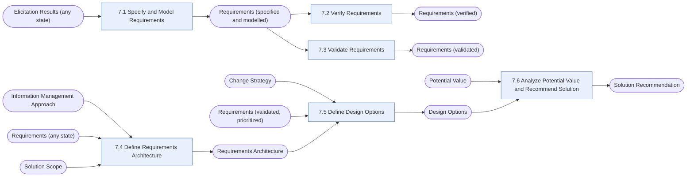

# Requirements Analysis and Design Definition (RADD)

> [!info] Exam weight: **30%** of CBAP questions (≈36 of 120)
> Structure and organize requirements, specify and model them, verify & validate them, define design options, and recommend the best-value solution.

## Tasks
| Task | Purpose | Outputs |
|---|---|---|
| [[Specify and Model Requirements|7.1 Specify and Model Requirements]] | Turn elicitation results into structured, modelled requirements and designs at the right level of detail. | [[Requirements (specified and modelled)]] |
| [[Verify Requirements|7.2 Verify Requirements]] | Check that requirement and design specifications are of good quality and fit for their purpose. | [[Requirements (verified)]] |
| [[Validate Requirements|7.3 Validate Requirements]] | Check that requirements and designs support the business requirements and will deliver the value that is needed. | [[Requirements (validated)]] |
| [[Define Requirements Architecture|7.4 Define Requirements Architecture]] | Make sure the requirements fit together as a coherent, complete whole that achieves the objectives. | [[Requirements Architecture]] |
| [[Define Design Options|7.5 Define Design Options]] | Work out the possible solution approaches, allocate requirements to components, and describe the design options. | [[Design Options]] |
| [[Analyze Potential Value and Recommend Solution|7.6 Analyze Potential Value and Recommend Solution]] | Compare the value of each design option and recommend the most suitable one, or none. | [[Solution Recommendation]] |

## Input → task → output flow

**Inputs from outside this KA:** [[Change Strategy]], [[Elicitation Results (any state)]], [[Information Management Approach]], [[Potential Value]], [[Requirements (any state)]], [[Requirements (validated, prioritized)]], [[Solution Scope]]

## Most-used techniques in this KA
- [[Acceptance and Evaluation Criteria]] — used in 4 of 6 tasks
- [[Interviews]] — used in 3 of 6 tasks
- [[Metrics and Key Performance Indicators (KPIs)]] — used in 3 of 6 tasks
- [[Workshops]] — used in 3 of 6 tasks
- [[Brainstorming]] — used in 2 of 6 tasks
- [[Business Model Canvas]] — used in 2 of 6 tasks
- [[Data Modelling]] — used in 2 of 6 tasks
- [[Document Analysis]] — used in 2 of 6 tasks
- [[Financial Analysis]] — used in 2 of 6 tasks
- [[Functional Decomposition]] — used in 2 of 6 tasks
- [[Item Tracking]] — used in 2 of 6 tasks
- [[Organizational Modelling]] — used in 2 of 6 tasks

> [!tip] Exam lens
> - 30% of the exam — the single biggest area. Master modelling categories (people & roles, rationale, activity flow, capability, data & information).
> - Verify = quality of the requirement (well-formed, correct form). Validate = alignment with business need/value.
> - Requirements Architecture ties requirements together — viewpoints and views, completeness.
> - Design options consider improvement opportunities, components, and allocation to solution components.

## Study guides
- **BABOK v3** chapter 7
- **Lessing** ch.10 *Requirements Analysis and Design Definition*, pp.229–275 (incl. knowledge quiz)
- **Jonasson** Ch 8 Requirements Analysis and Design Definition, from p.169

Up: [[00 CBAP Knowledge Graph]]
