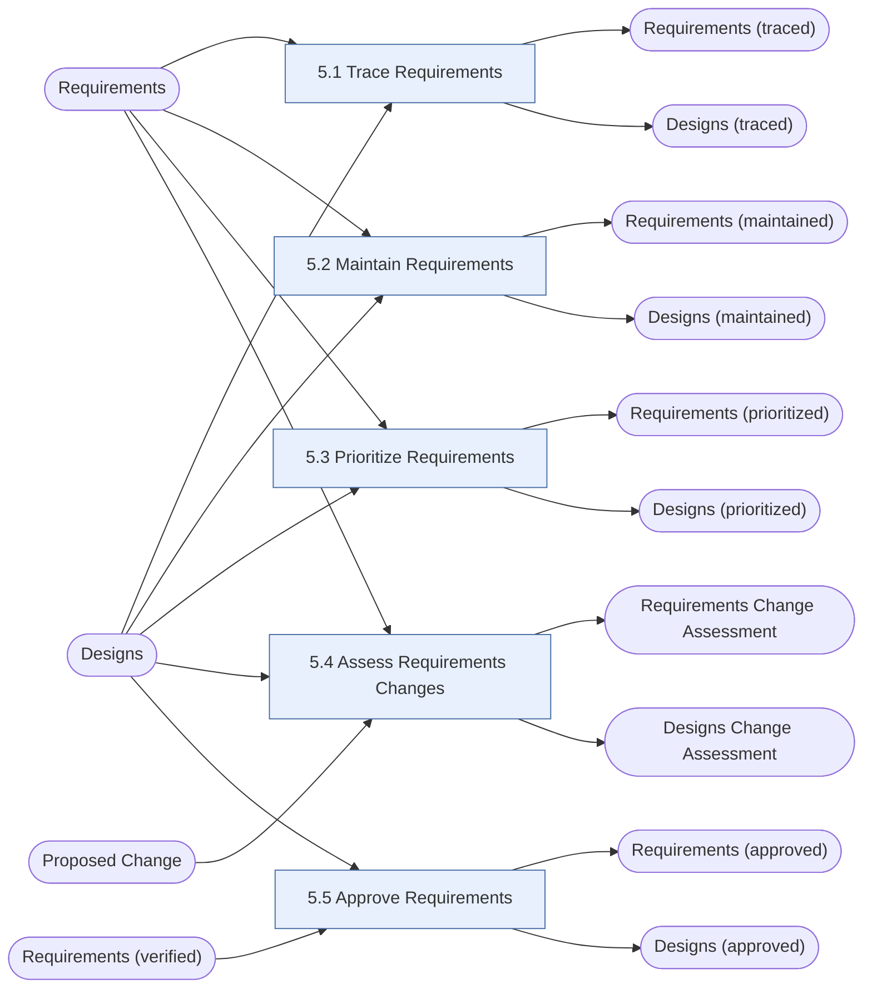

# Requirements Life Cycle Management (RLCM)

> [!info] Exam weight: **15%** of CBAP questions (≈18 of 120)
> Manage and maintain requirements and designs from inception to retirement: trace, maintain, prioritize, assess changes, approve.

## Tasks
| Task | Purpose | Outputs |
|---|---|---|
| [[Trace Requirements|5.1 Trace Requirements]] | Link requirements and designs across levels so that alignment, coverage and the impact of changes are visible. | [[Requirements (traced)]], [[Designs (traced)]] |
| [[Maintain Requirements|5.2 Maintain Requirements]] | Keep requirements correct, consistent and well-attributed over their whole life, and make them reusable. | [[Requirements (maintained)]], [[Designs (maintained)]] |
| [[Prioritize Requirements|5.3 Prioritize Requirements]] | Rank requirements and designs by relative importance, with stakeholders, and keep doing so as things change. | [[Requirements (prioritized)]], [[Designs (prioritized)]] |
| [[Assess Requirements Changes|5.4 Assess Requirements Changes]] | Work out what a proposed change to requirements or designs would mean (benefit, cost, impact, schedule, urgency) and resolve it through governance. | [[Requirements Change Assessment]], [[Designs Change Assessment]] |
| [[Approve Requirements|5.5 Approve Requirements]] | Reach agreement and approval on requirements and designs so that work can continue. | [[Requirements (approved)]], [[Designs (approved)]] |

## Input → task → output flow

**Inputs from outside this KA:** [[Designs]], [[Proposed Change]], [[Requirements]], [[Requirements (verified)]]

## Most-used techniques in this KA
- [[Business Rules Analysis]] — used in 3 of 5 tasks
- [[Decision Analysis]] — used in 3 of 5 tasks
- [[Item Tracking]] — used in 3 of 5 tasks
- [[Workshops]] — used in 3 of 5 tasks
- [[Business Cases]] — used in 2 of 5 tasks
- [[Document Analysis]] — used in 2 of 5 tasks
- [[Estimation]] — used in 2 of 5 tasks
- [[Financial Analysis]] — used in 2 of 5 tasks
- [[Functional Decomposition]] — used in 2 of 5 tasks
- [[Interviews]] — used in 2 of 5 tasks
- [[Process Modelling]] — used in 2 of 5 tasks
- [[Risk Analysis and Management]] — used in 2 of 5 tasks

> [!tip] Exam lens
> - Life cycle runs until the requirement is *retired* — not until the project ends.
> - Traceability relationships: derive, depends (necessity / effort), satisfy, validate.
> - Prioritization basis: benefit, penalty, cost, risk, dependencies, time sensitivity, stability, regulatory/policy compliance.
> - Approve Requirements needs *verified* requirements as input — not validated.

## Study guides
- **BABOK v3** chapter 5
- **Lessing** ch.8 *Requirements Life Cycle Management*, pp.148–184 (incl. knowledge quiz)
- **Jonasson** Ch 6 Requirements Life Cycle Management, from p.135

Up: [[00 CBAP Knowledge Graph]]
