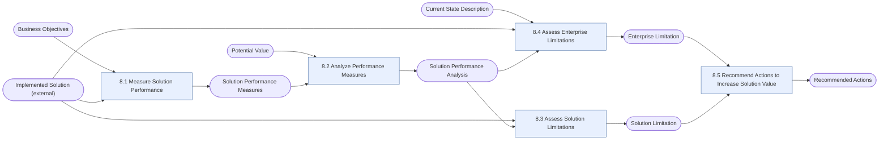

# Solution Evaluation (SE)

> [!info] Exam weight: **14%** of CBAP questions (≈17 of 120)
> Assess the performance and value of a solution in use (or being built) and recommend actions to increase value.

## Tasks
| Task | Purpose | Outputs |
|---|---|---|
| [[Measure Solution Performance|8.1 Measure Solution Performance]] | Define, validate and collect the measures that show how a solution is performing. | [[Solution Performance Measures]] |
| [[Analyze Performance Measures|8.2 Analyze Performance Measures]] | Interpret the performance measures to see how the solution is delivering value compared with what was expected. | [[Solution Performance Analysis]] |
| [[Assess Solution Limitations|8.3 Assess Solution Limitations]] | Find the factors inside the solution that stop it from delivering its full value. | [[Solution Limitation]] |
| [[Assess Enterprise Limitations|8.4 Assess Enterprise Limitations]] | Find the factors in the wider enterprise (culture, structure, operations) that stop the solution from delivering value. | [[Enterprise Limitation]] |
| [[Recommend Actions to Increase Solution Value|8.5 Recommend Actions to Increase Solution Value]] | Recommend actions that close the gap between the potential and actual value of the solution. | [[Recommended Actions]] |

## Input → task → output flow

**Inputs from outside this KA:** [[Business Objectives]], [[Current State Description]], [[Implemented Solution (external)]], [[Potential Value]]

## Most-used techniques in this KA
- [[Data Mining]] — used in 5 of 5 tasks
- [[Survey or Questionnaire]] — used in 5 of 5 tasks
- [[Benchmarking and Market Analysis]] — used in 4 of 5 tasks
- [[Decision Analysis]] — used in 4 of 5 tasks
- [[Risk Analysis and Management]] — used in 4 of 5 tasks
- [[Acceptance and Evaluation Criteria]] — used in 3 of 5 tasks
- [[Interviews]] — used in 3 of 5 tasks
- [[Observation]] — used in 3 of 5 tasks
- [[Root Cause Analysis]] — used in 3 of 5 tasks
- [[Focus Groups]] — used in 2 of 5 tasks
- [[Item Tracking]] — used in 2 of 5 tasks
- [[Lessons Learned]] — used in 2 of 5 tasks

> [!tip] Exam lens
> - Applies to solutions in *any* state: prototypes, pilots, betas, and operational releases.
> - Solution limitations (inside the solution) vs enterprise limitations (culture, operations, structure outside the solution).
> - Recommended actions may include "do nothing", organizational change, reduce complexity, eliminate redundancy, retire.
> - Measures can be quantitative or qualitative; analysis looks at trends, accuracy, variance vs potential value.

## Study guides
- **BABOK v3** chapter 8
- **Lessing** ch.11 *Solution Evaluation*, pp.276–315 (incl. knowledge quiz)
- **Jonasson** Ch 9 Solution Evaluation, from p.221

Up: [[00 CBAP Knowledge Graph]]
