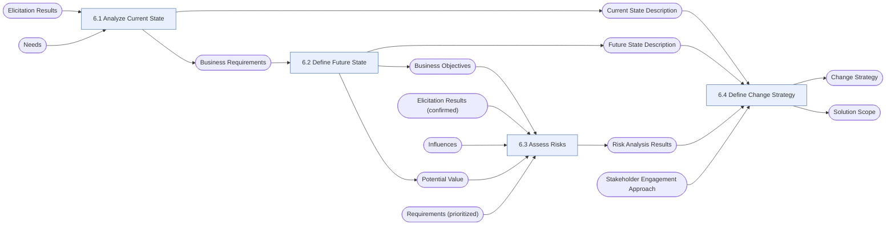

# Strategy Analysis (SA)

> [!info] Exam weight: **15%** of CBAP questions (≈18 of 120)
> Define the business need, current state, future state, risks, and the change strategy that bridges them.

## Tasks
| Task | Purpose | Outputs |
|---|---|---|
| [[Analyze Current State|6.1 Analyze Current State]] | Understand why the enterprise needs to change and what the change would affect, starting from how things work today. | [[Current State Description]], [[Business Requirements]] |
| [[Define Future State|6.2 Define Future State]] | Describe the target conditions that would satisfy the business need, including measurable objectives and the value expected. | [[Business Objectives]], [[Future State Description]], [[Potential Value]] |
| [[Assess Risks|6.3 Assess Risks]] | Identify and weigh the uncertainties that could reduce value during the transition or in the future state, and recommend how to proceed. | [[Risk Analysis Results]] |
| [[Define Change Strategy|6.4 Define Change Strategy]] | Compare ways of getting from the current to the future state, pick one, and define the solution scope and transition path. | [[Change Strategy]], [[Solution Scope]] |

## Input → task → output flow

**Inputs from outside this KA:** [[Elicitation Results]], [[Elicitation Results (confirmed)]], [[Influences]], [[Needs]], [[Requirements (prioritized)]], [[Stakeholder Engagement Approach]]

## Most-used techniques in this KA
- [[Business Cases]] — used in 4 of 4 tasks
- [[Financial Analysis]] — used in 4 of 4 tasks
- [[Interviews]] — used in 4 of 4 tasks
- [[Lessons Learned]] — used in 4 of 4 tasks
- [[Mind Mapping]] — used in 4 of 4 tasks
- [[Workshops]] — used in 4 of 4 tasks
- [[Benchmarking and Market Analysis]] — used in 3 of 4 tasks
- [[Brainstorming]] — used in 3 of 4 tasks
- [[Business Capability Analysis]] — used in 3 of 4 tasks
- [[Business Model Canvas]] — used in 3 of 4 tasks
- [[Decision Analysis]] — used in 3 of 4 tasks
- [[Functional Decomposition]] — used in 3 of 4 tasks

> [!tip] Exam lens
> - Flow to memorize: Current State → Future State → Assess Risks → Change Strategy.
> - Business Requirements are born in Analyze Current State (6.1) — the "why" of the change.
> - Define Change Strategy outputs BOTH Change Strategy and Solution Scope.
> - Transition states and release planning live in 6.4, not in RADD.

## Study guides
- **BABOK v3** chapter 6
- **Lessing** ch.9 *Strategy Analysis*, pp.185–228 (incl. knowledge quiz)
- **Jonasson** Ch 7 Strategy Analysis, from p.141

Up: [[00 CBAP Knowledge Graph]]
