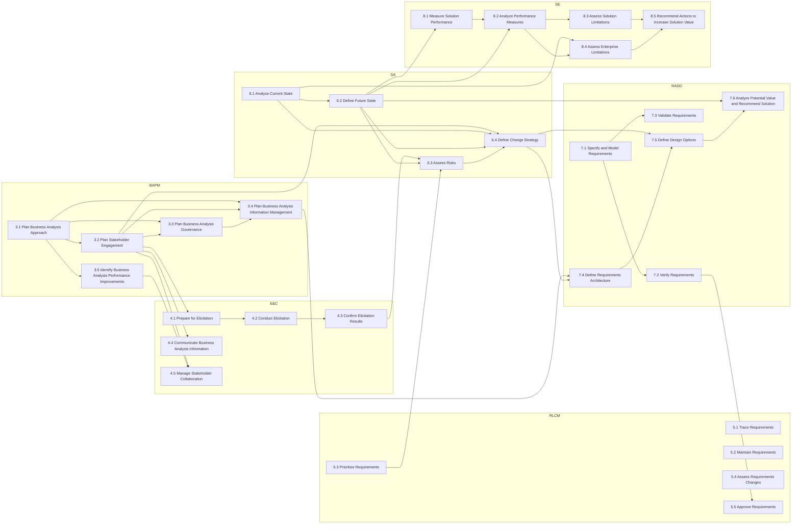

# BABOK Input–Output Flow

Which task feeds which: an arrow means an **output** of one task is a formal **input** of the other. Guidelines are left out to keep it readable; see each task note for those. 38 task-to-task handoffs.

## Handoff table
| From task | Work product | To task |
|---|---|---|
| [[Plan Business Analysis Approach|3.1 Plan Business Analysis Approach]] | [[Business Analysis Approach]] | [[Plan Stakeholder Engagement|3.2 Plan Stakeholder Engagement]] |
| [[Plan Business Analysis Approach|3.1 Plan Business Analysis Approach]] | [[Business Analysis Approach]] | [[Plan Business Analysis Governance|3.3 Plan Business Analysis Governance]] |
| [[Plan Business Analysis Approach|3.1 Plan Business Analysis Approach]] | [[Business Analysis Approach]] | [[Plan Business Analysis Information Management|3.4 Plan Business Analysis Information Management]] |
| [[Plan Business Analysis Approach|3.1 Plan Business Analysis Approach]] | [[Business Analysis Approach]] | [[Identify Business Analysis Performance Improvements|3.5 Identify Business Analysis Performance Improvements]] |
| [[Plan Stakeholder Engagement|3.2 Plan Stakeholder Engagement]] | [[Stakeholder Engagement Approach]] | [[Plan Business Analysis Governance|3.3 Plan Business Analysis Governance]] |
| [[Plan Stakeholder Engagement|3.2 Plan Stakeholder Engagement]] | [[Stakeholder Engagement Approach]] | [[Plan Business Analysis Information Management|3.4 Plan Business Analysis Information Management]] |
| [[Plan Stakeholder Engagement|3.2 Plan Stakeholder Engagement]] | [[Stakeholder Engagement Approach]] | [[Prepare for Elicitation|4.1 Prepare for Elicitation]] |
| [[Plan Stakeholder Engagement|3.2 Plan Stakeholder Engagement]] | [[Stakeholder Engagement Approach]] | [[Communicate Business Analysis Information|4.4 Communicate Business Analysis Information]] |
| [[Plan Stakeholder Engagement|3.2 Plan Stakeholder Engagement]] | [[Stakeholder Engagement Approach]] | [[Manage Stakeholder Collaboration|4.5 Manage Stakeholder Collaboration]] |
| [[Plan Stakeholder Engagement|3.2 Plan Stakeholder Engagement]] | [[Stakeholder Engagement Approach]] | [[Define Change Strategy|6.4 Define Change Strategy]] |
| [[Plan Business Analysis Governance|3.3 Plan Business Analysis Governance]] | [[Governance Approach]] | [[Plan Business Analysis Information Management|3.4 Plan Business Analysis Information Management]] |
| [[Plan Business Analysis Information Management|3.4 Plan Business Analysis Information Management]] | [[Information Management Approach]] | [[Define Requirements Architecture|7.4 Define Requirements Architecture]] |
| [[Identify Business Analysis Performance Improvements|3.5 Identify Business Analysis Performance Improvements]] | [[Business Analysis Performance Assessment]] | [[Manage Stakeholder Collaboration|4.5 Manage Stakeholder Collaboration]] |
| [[Prepare for Elicitation|4.1 Prepare for Elicitation]] | [[Elicitation Activity Plan]] | [[Conduct Elicitation|4.2 Conduct Elicitation]] |
| [[Conduct Elicitation|4.2 Conduct Elicitation]] | [[Elicitation Results (unconfirmed)]] | [[Confirm Elicitation Results|4.3 Confirm Elicitation Results]] |
| [[Confirm Elicitation Results|4.3 Confirm Elicitation Results]] | [[Elicitation Results (confirmed)]] | [[Assess Risks|6.3 Assess Risks]] |
| [[Prioritize Requirements|5.3 Prioritize Requirements]] | [[Requirements (prioritized)]] | [[Assess Risks|6.3 Assess Risks]] |
| [[Analyze Current State|6.1 Analyze Current State]] | [[Business Requirements]] | [[Define Future State|6.2 Define Future State]] |
| [[Analyze Current State|6.1 Analyze Current State]] | [[Current State Description]] | [[Define Change Strategy|6.4 Define Change Strategy]] |
| [[Analyze Current State|6.1 Analyze Current State]] | [[Current State Description]] | [[Assess Enterprise Limitations|8.4 Assess Enterprise Limitations]] |
| [[Define Future State|6.2 Define Future State]] | [[Business Objectives]], [[Potential Value]] | [[Assess Risks|6.3 Assess Risks]] |
| [[Define Future State|6.2 Define Future State]] | [[Future State Description]] | [[Define Change Strategy|6.4 Define Change Strategy]] |
| [[Define Future State|6.2 Define Future State]] | [[Potential Value]] | [[Analyze Potential Value and Recommend Solution|7.6 Analyze Potential Value and Recommend Solution]] |
| [[Define Future State|6.2 Define Future State]] | [[Business Objectives]] | [[Measure Solution Performance|8.1 Measure Solution Performance]] |
| [[Define Future State|6.2 Define Future State]] | [[Potential Value]] | [[Analyze Performance Measures|8.2 Analyze Performance Measures]] |
| [[Assess Risks|6.3 Assess Risks]] | [[Risk Analysis Results]] | [[Define Change Strategy|6.4 Define Change Strategy]] |
| [[Define Change Strategy|6.4 Define Change Strategy]] | [[Solution Scope]] | [[Define Requirements Architecture|7.4 Define Requirements Architecture]] |
| [[Define Change Strategy|6.4 Define Change Strategy]] | [[Change Strategy]] | [[Define Design Options|7.5 Define Design Options]] |
| [[Specify and Model Requirements|7.1 Specify and Model Requirements]] | [[Requirements (specified and modelled)]] | [[Verify Requirements|7.2 Verify Requirements]] |
| [[Specify and Model Requirements|7.1 Specify and Model Requirements]] | [[Requirements (specified and modelled)]] | [[Validate Requirements|7.3 Validate Requirements]] |
| [[Verify Requirements|7.2 Verify Requirements]] | [[Requirements (verified)]] | [[Approve Requirements|5.5 Approve Requirements]] |
| [[Define Requirements Architecture|7.4 Define Requirements Architecture]] | [[Requirements Architecture]] | [[Define Design Options|7.5 Define Design Options]] |
| [[Define Design Options|7.5 Define Design Options]] | [[Design Options]] | [[Analyze Potential Value and Recommend Solution|7.6 Analyze Potential Value and Recommend Solution]] |
| [[Measure Solution Performance|8.1 Measure Solution Performance]] | [[Solution Performance Measures]] | [[Analyze Performance Measures|8.2 Analyze Performance Measures]] |
| [[Analyze Performance Measures|8.2 Analyze Performance Measures]] | [[Solution Performance Analysis]] | [[Assess Solution Limitations|8.3 Assess Solution Limitations]] |
| [[Analyze Performance Measures|8.2 Analyze Performance Measures]] | [[Solution Performance Analysis]] | [[Assess Enterprise Limitations|8.4 Assess Enterprise Limitations]] |
| [[Assess Solution Limitations|8.3 Assess Solution Limitations]] | [[Solution Limitation]] | [[Recommend Actions to Increase Solution Value|8.5 Recommend Actions to Increase Solution Value]] |
| [[Assess Enterprise Limitations|8.4 Assess Enterprise Limitations]] | [[Enterprise Limitation]] | [[Recommend Actions to Increase Solution Value|8.5 Recommend Actions to Increase Solution Value]] |

> [!tip] How to study this
> Cover the right-hand column and recall where each output goes next. "What should the BA do next?" questions are usually answered by this table.

Up: [[Exam Blueprint]]
