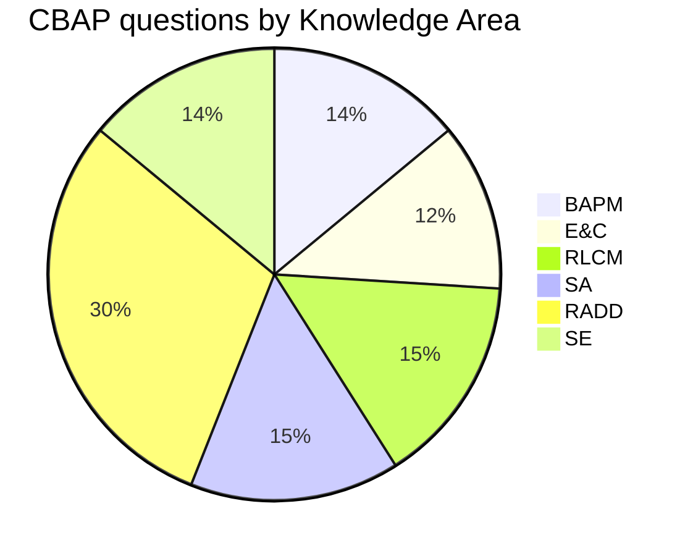

# Exam Blueprint (CBAP, IIBA Handbook May 2026)

120 questions · 210 minutes · multiple-choice, scenario and case-study questions · online proctored or at a PSI test center · based on BABOK v3.

| KA | Weight | ≈ Questions | Tasks | Distinct techniques |
|---|---|---|---|---|
| [[Business Analysis Planning and Monitoring]] | 14% | 17 | 5 | 23 |
| [[Elicitation and Collaboration]] | 12% | 14 | 5 | 23 |
| [[Requirements Life Cycle Management]] | 15% | 18 | 5 | 22 |
| [[Strategy Analysis]] | 15% | 18 | 4 | 33 |
| [[Requirements Analysis and Design Definition]] | 30% | 36 | 6 | 44 |
| [[Solution Evaluation]] | 14% | 17 | 5 | 29 |

## Exam-day heuristics
- Read the LAST sentence of a case question first — it tells you what is asked (task, technique, output, next step).
- Pick the "most BABOK" answer: the one that follows the task's purpose and uses its inputs/outputs, even if another answer works in real life.
- State labels on outputs are clues: unconfirmed → confirmed; specified & modelled → verified → validated/prioritized → approved.
- When stuck between two plausible answers, prefer the one that involves stakeholders / collaboration and addresses value.
- Know which task PRODUCES each output and which tasks CONSUME it — it answers "what comes next" questions.

See also: [[BABOK Input-Output Flow]] · [[Commonly Confused Concepts]] · [[Technique-Task Matrix]]
